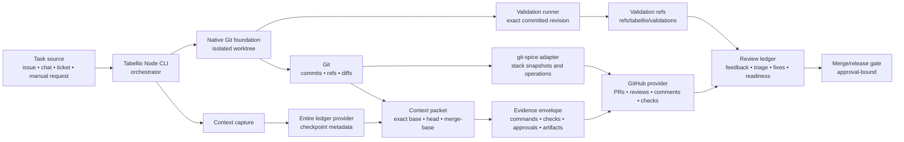
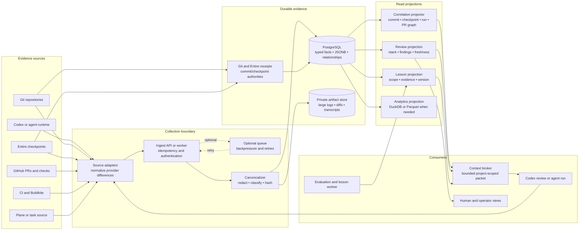
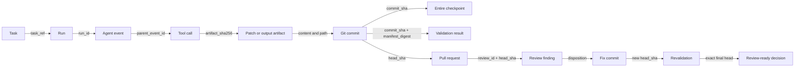
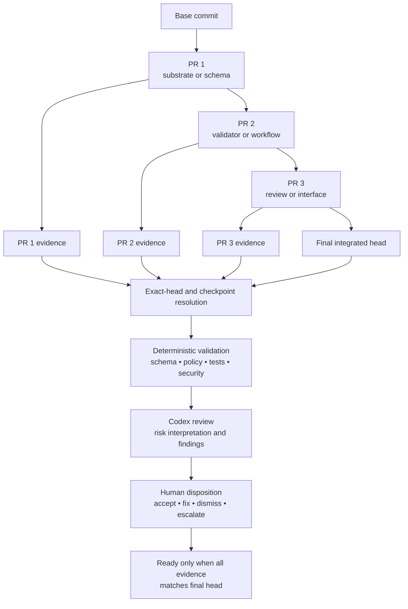
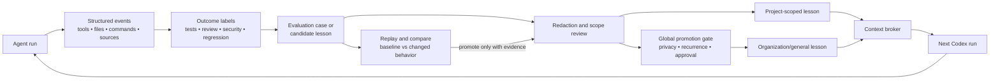
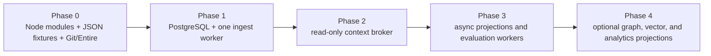

# Tabellio System Architecture Diagrams

Status: Proposed target architecture  
Date: 2026-08-30  
Purpose: Visualize the current Tabellio implementation, the proposed provenance architecture, and the service boundaries that may be extracted later.

The provenance-backed D2 model and structured review live in [the provenance-ledger proposal](architecture/proposals/provenance-ledger/SYSTEM_DESIGN.md).

## How to read these diagrams

The diagrams use four views:

1. Current implementation: the Node.js and Git-native workflow.
2. Target topology: collection, durable evidence, projections, and Codex consumers.
3. Correlation: exact IDs connecting agent activity to code, review, and deployment evidence.
4. Feedback: how validated outcomes become scoped context and evaluation cases.

The target boxes are logical boundaries first. They do not mean that every box should immediately become an independently deployed microservice.

## 1. Current Tabellio architecture

Tabellio is currently a Node.js CLI and provider/adaptor system. Git, Entire, GitHub, and validation workers remain separate systems. Tabellio binds their records and validates the relationships.



Current boundary:

- JSON is the portable contract.
- Git is the code authority.
- Entire is the checkpoint and session authority.
- GitHub is the code and pull-request surface.
- Tabellio owns evidence validation and policy checks.
- Validation workers may be local or operator-managed.
- No central provenance database or always-running Tabellio daemon exists yet.

## 2. Proposed target topology

The target architecture separates collection, durable evidence, query projections, and Codex feedback. Git and Entire remain upstream sources of truth for their own domains.



The database is an index and evidence store. It does not replace Git or Entire. The artifact store holds large content by digest; PostgreSQL stores the metadata and relationships needed to find and authorize it.

## 3. Provenance correlation model

The same work is represented as facts plus relationships. IDs and digests create the joins.



Primary correlation keys:

| Relationship | Required identity |
| --- | --- |
| Task to run | task reference and run ID |
| Event to run | run ID and event ID |
| Tool output to artifact | artifact SHA-256 |
| Artifact to code | path plus exact commit SHA |
| Commit to checkpoint | repository ID, commit SHA, checkpoint ID, checkpoint digest |
| Commit to validation | repository ID, commit SHA, manifest digest |
| PR review to code | repository ID, PR number, exact head SHA |
| Finding to fix | finding ID, original head SHA, fix commit SHA |
| Lesson to evidence | lesson ID, evidence record IDs, scope |

Do not correlate by title, branch display name, or timestamp alone. When the head changes, old review and validation records remain historical but cannot authorize the new head.

## 4. PR stack and final review

Every stacked PR gets local evidence. The final integrated head gets a new review and validation pass.



Codex review is a review and interpretation capability. Deterministic security and validation controls remain the authority for their declared checks.

## 5. Evidence-to-Codex feedback loop

The system improves future behavior through controlled retrieval and evaluation, not silent global self-modification.



Retrieval order:

1. Exact project and repository.
2. Path and risk type.
3. Validation strength.
4. Repeated outcome evidence.
5. Recency as a tie-breaker.

Semantic search may find similar cases. It must not decide correctness, security, approval, or merge readiness.

## 6. Capability-to-service map

These are logical service boundaries. Current implementation is mostly a Node.js CLI with provider adapters; future deployment may keep several boundaries in one process.

| Capability | Current Tabellio capability | Proposed boundary | First technique |
| --- | --- | --- | --- |
| Git and worktree control | NativeGitStore and native Git foundation | Repository adapter | Exact immutable SHAs, isolated worktrees, compare-and-swap refs |
| Checkpoint lineage | EntireLedgerProvider and context capture | Entire adapter | Provider normalization, checkpoint ID and digest binding |
| Stack management | GitSpiceStackManager | Stack adapter | Parent/child snapshot, restack mapping, operation receipts |
| GitHub review state | GitHubProvider and review commands | GitHub adapter | Head-SHA freshness, bounded API reads, stale retention |
| Evidence validation | Evidence schemas and validators | Policy/validation worker | JSON Schema, exact keys, cross-field checks, default deny |
| Event collection | Partial provider adapters | Ingest adapter layer | Idempotency key, canonical event envelope, redaction |
| Provenance storage | Git refs and JSON artifacts today | Ledger service | PostgreSQL typed fields, JSONB payloads, foreign keys |
| Relationship correlation | Current exact-head and checkpoint joins | Correlation projector | Typed edges, DAG traversal, topological ordering |
| Large evidence | Artifact references and digests | Artifact service | Content-addressed storage, ACL, retention class |
| Codex context | Context packets today | Read-only context broker or MCP tool | Scope filters, evidence references, bounded output |
| Review intelligence | Codex review contract | Review worker | Deterministic gates first, model interpretation second |
| Agent improvement | Evals and design direction | Evaluation/lesson worker | Trace labeling, replay, graders, versioned promotion |
| Capacity and retries | Scheduler-agnostic CLI contracts | External scheduler/queue | Backpressure, retry, dead-letter handling |

## 7. Techniques that make this work

### Append-only facts

Treat observed events as immutable. Corrections create a new event or disposition. Do not rewrite original evidence silently.

### Typed envelopes with flexible payloads

Use a stable envelope for identity, trust, scope, and integrity. Keep provider-specific fields in JSONB until they become important enough to promote into typed columns.

### Idempotent ingestion

Every adapter should derive an idempotency key from source, source event ID, repository, commit, and payload digest. Retries must not duplicate evidence.

### Transactional relationship writes

Insert a fact and its critical relationships together. Reject references to unknown repositories, commits, checkpoints, validations, or reviews.

### Content-addressed artifacts

Hash large outputs. Store the digest, media type, URI, sensitivity, and retention policy in the ledger. Keep raw content behind access control.

### Projections instead of one giant record

Keep the ledger normalized. Build read projections for current stack state, review readiness, lineage, analytics, and lessons. Rebuild projections when their logic changes.

### DAG-aware ordering

Use Git ancestry for commits and parent/causal edges for agent events. Topological ordering is safer than timestamps when determining what could have influenced what.

### Freshness as a first-class field

Every review and validation record should identify the exact head it assessed. A new head creates a new assessment requirement.

### Scoped retrieval

Project-specific context is private by default. Global lessons require redaction, recurrence, approval, and evaluation evidence.

### Modular monolith first

Implement the boundaries as Node.js modules and worker commands first. Extract network services only when scale, independent deployment, fault isolation, or access control requires it.

## 8. Deployment evolution



Do not begin with a fleet of microservices. First prove one complete lineage:

```
task -> agent event -> artifact -> commit -> checkpoint -> validation -> PR -> finding -> fix -> final review
```

Then measure event volume, query latency, retention, concurrency, and project isolation. Those measurements decide which boundaries deserve independent deployment.

## 9. Capability references

Current repository contracts:

- [Agent provenance ledger and Codex feedback plan](agent-provenance-ledger-and-codex-feedback.md)
- [Workflow model](workflow-model.md)
- [Tooling stack](tooling-stack.md)
- [Evidence schema](evidence-schema.md)
- [Validation runner](validation-runner.md)
- [Codex review](codex-review.md)
- [Review loop](review-loop.md)
- [Operations hardening](operations-hardening.md)

Current implementation entry points:

- [Context capture](../scripts/capture-tabellio-context.mjs)
- [Entire ledger provider](../scripts/providers/entire-ledger-provider.mjs)
- [git-spice stack manager](../scripts/providers/git-spice-stack-manager.mjs)
- [GitHub provider](../scripts/providers/github-provider.mjs)
- [Review command](../scripts/tabellio-review.mjs)
- [Validation command](../scripts/tabellio-validator.mjs)
- [Control-ref transport](../scripts/lib/control-ref-transport.mjs)

External references:

- [SLSA provenance](https://slsa.dev/spec/v1.0/levels)
- [in-toto](https://in-toto.io/docs/getting-started/)
- [OpenTelemetry](https://opentelemetry.io/docs/what-is-opentelemetry/)
- [OpenAI tracing and observability](https://developers.openai.com/api/docs/guides/agents/integrations-observability)
- [OpenAI agent evaluations](https://developers.openai.com/api/docs/guides/agent-evals)
- [PostgreSQL JSON types](https://www.postgresql.org/docs/current/datatype-json.html)
- [PostgreSQL constraints](https://www.postgresql.org/docs/current/ddl-constraints.html)
- [PostgreSQL recursive queries](https://www.postgresql.org/docs/current/queries-with.html)
- [git-spice](https://abhinav.github.io/git-spice/)
- [Entire](https://entire.io/)
